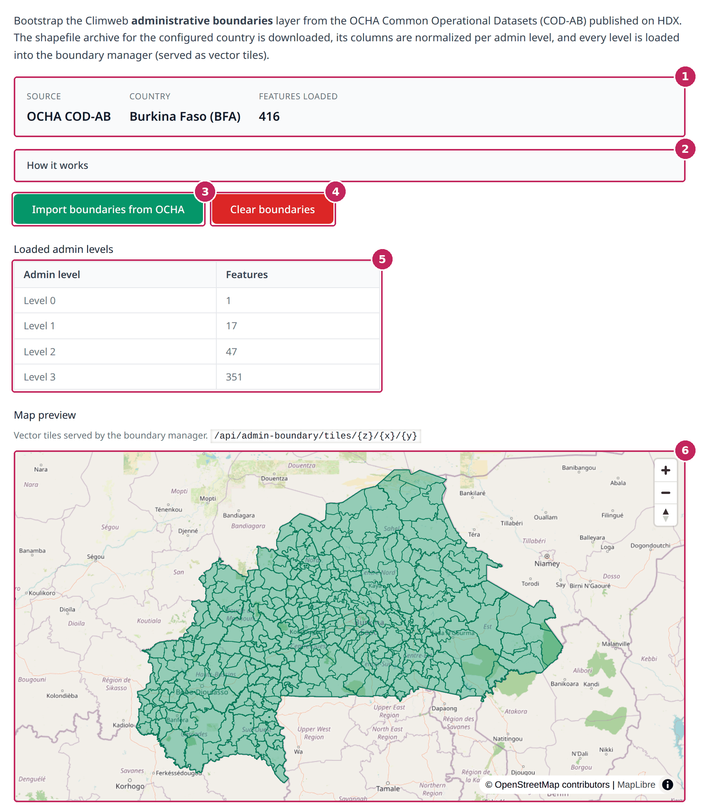

# Admin Boundaries

The **Admin Boundaries** tab of the [Dataset Helper](index.md) imports the administrative boundaries of your country (country, regions, provinces, communes, etc.) in one click. ClimWeb uses these boundaries wherever an administrative area is needed, for example to [define the area of a CAP alert](../manage_cap/Setting-Boundaries.md).

The boundaries come from the **OCHA Common Operational Datasets – Administrative Boundaries (COD-AB)**, the reference boundaries used by humanitarian organisations, published on the [Humanitarian Data Exchange (HDX)](https://data.humdata.org/). This tab is independent of the [Layer Catalog](Layer-Catalog.md): it does not create any dataset in the MapViewer.



**1. Summary**: the source of the boundaries, the country chosen in the [Settings](Settings.md) and the number of administrative areas loaded for this country.

**2. How it works**: click to display a short description of the import steps.

**3. Import boundaries from OCHA**: downloads the boundaries of your country from HDX and loads all their levels into ClimWeb. The import can take a few minutes. When it is complete, a message lists the number of areas loaded for each level.

**4. Clear boundaries**: deletes all the administrative boundaries of your country, at all levels. You are asked to confirm, and the action cannot be undone.

**5. Loaded admin levels**: the number of areas loaded for each administrative level. Level 0 is the country itself, level 1 the first subdivision (for example regions), level 2 the second one (for example provinces), and so on. The number of levels depends on the country.

**6. Map preview**: the boundaries as they are served by ClimWeb, centred on your country. Zoom in to see the smaller areas. The map is refreshed after each import.

---

## Import the boundaries

1. Check that the right country is selected in the [Settings](Settings.md). The **Country** of the summary shows *not configured* as long as no country has been saved.
2. Click **Import boundaries from OCHA** and wait until the result message is displayed.
3. Check the number of areas in the **Loaded admin levels** table and the boundaries on the map preview.

You can run the import again at any time, for example when OCHA publishes a new version of the boundaries of your country: the levels loaded previously for your country are replaced.

The names of the areas are imported in French when the import language of the [Settings](Settings.md) is French, and in English otherwise.

```{note}
The import button is disabled, and a message explains why, when no country is configured or when the boundary tools are not available on your ClimWeb instance. The boundaries can also be loaded manually, from files, in the Geo Manager: see [Setting Boundaries](../manage_cap/Setting-Boundaries.md).
```
