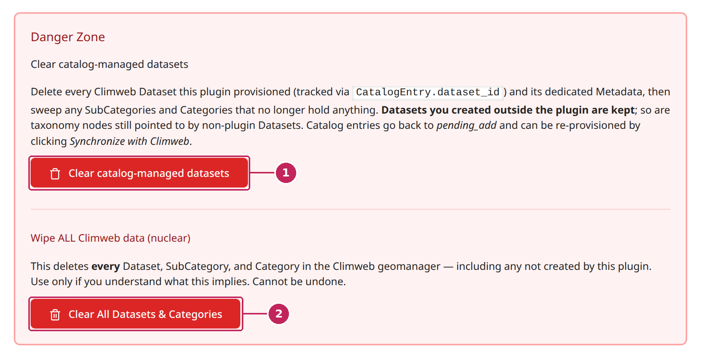

# Danger Zone

The **Danger Zone** tab of the [Dataset Helper](index.md) groups the actions that delete datasets of the MapViewer in bulk. Together with the **Reset Catalog** button of the [Layer Catalog](Layer-Catalog.md), they are meant for the initial setup of ClimWeb or for cleaning up after a mistake.

```{warning}
These actions cannot be undone. On a ClimWeb website that is already in use, prefer unchecking the layers you no longer want and [synchronizing with ClimWeb](Layer-Catalog.md#synchronize-with-climweb).
```



**1. Clear catalog-managed datasets**: deletes the datasets created by the Dataset Helper, and keeps your selection. See [Clear catalog-managed datasets](#clear-catalog-managed-datasets).

**2. Clear All Datasets & Categories**: deletes all the datasets, categories and sub-categories of the Geo Manager, including the ones you have created yourself. See [Clear all datasets and categories](#clear-all-datasets-and-categories).

Each action asks for confirmation before deleting anything, and displays the number of deleted items when it is complete.

---

## Clear catalog-managed datasets

This action removes from ClimWeb everything the Dataset Helper has created, but keeps the catalog and your selection:

- the datasets created by the Dataset Helper, and their metadata, are deleted,
- the categories and sub-categories that no longer contain any dataset are deleted,
- the datasets, categories and sub-categories you have created yourself in the Geo Manager are kept,
- in the catalog, the checked layers go back to the *To add* status.

Use it to rebuild the MapViewer layers from a clean state, for example when many datasets have been edited by hand in the Geo Manager and you want to go back to the content of the catalog. Click **Synchronize with Climweb** afterwards to create the datasets of your selection again.

---

## Clear all datasets and categories

This action empties the Geo Manager:

- **all** the datasets, with their layers, metadata and styles, are deleted, whether they have been created by the Dataset Helper or by hand,
- **all** the categories and sub-categories are deleted,
- the catalog of the Dataset Helper is kept: the checked layers go back to the *To add* status.

After this action, the MapViewer no longer contains any layer. Because of its impact, it asks for confirmation twice. The items that are still used elsewhere in ClimWeb cannot be deleted: they are listed in the result.

Only use it if you really want to start again from an empty MapViewer.

---

## Reset Catalog

The **Reset Catalog** button, at the top right of the [layer tree](Layer-Catalog.md#the-layer-tree), brings the Dataset Helper back to its state before the catalog was loaded:

- the datasets created by the Dataset Helper, and their metadata, are deleted,
- the categories and sub-categories that no longer contain any dataset are deleted,
- the datasets, categories and sub-categories you have created yourself in the Geo Manager are kept,
- the catalog is emptied: your selection is lost and the tab shows *No catalog loaded yet* again.

You can then [load the catalog](Layer-Catalog.md#load-the-catalog) again, for example after changing the import language, the ECMWF token or the eStation URL in the [Settings](Settings.md).

---

## Summary

| Action | Datasets created by the Dataset Helper | Datasets created by hand | Categories and sub-categories | Catalog and selection |
| --- | --- | --- | --- | --- |
| Uncheck a layer and synchronize | Deleted for the unchecked layer | Kept | Kept | Kept |
| Clear catalog-managed datasets | Deleted | Kept | Deleted when empty | Kept, checked layers back to *To add* |
| Clear All Datasets & Categories | Deleted | **Deleted** | **All deleted** | Kept, checked layers back to *To add* |
| Reset Catalog | Deleted | Kept | Deleted when empty | **Emptied** |
