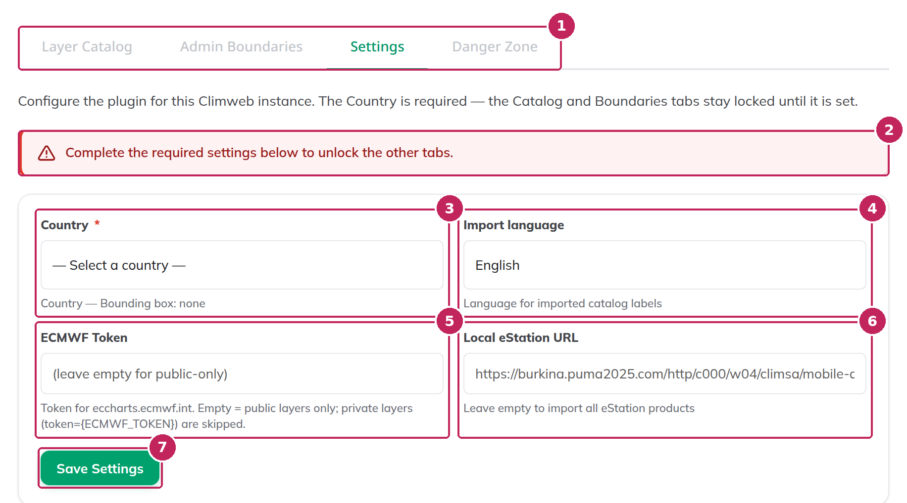
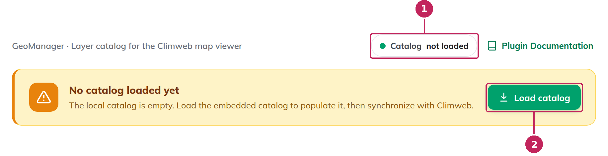
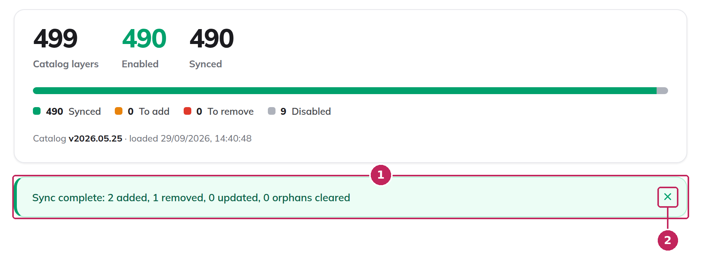

# Get started

This page takes you from an empty MapViewer to published data layers in three steps: configure the settings, load the catalog, and synchronize with ClimWeb. Each step links to the detailed documentation if you need more information.

To begin, [open the Dataset Helper](index.md#open-the-dataset-helper): in the ClimWeb admin, click **Geo Manager** in the main menu, then **Dataset helper**.

---

## 1. Configure the settings

The first time you open the Dataset Helper, it shows the **Settings** tab, and the other tabs are locked.



1. Choose your **Country**. This is the only required setting.
2. Check the **Import language**: the names and descriptions of the layers are loaded in this language.
3. Optionally, enter your **ECMWF Token** to also load the ECMWF layers that require one, and your **Local eStation URL** if your institution runs its own eStation.
4. Click **Save Settings**. The other tabs are unlocked.

```{note}
The import language, the ECMWF token and the eStation URL are only applied when the catalog is loaded. Fill them in now: to apply them to a catalog that is already loaded, you have to [reset the catalog](Danger-Zone.md#reset-catalog) and load it again.
```

See [Settings](Settings.md) for the details of each setting.

---

## 2. Load the catalog

Open the **Layer Catalog** tab, or click **Configure the catalog** below the saved settings. As long as the catalog is empty, the tab only shows a **Load catalog** button.



1. Click **Load catalog**. All the layers of the catalog are loaded and checked, with the *To add* status (orange dot). Nothing is published in the MapViewer yet.
2. Uncheck the layers you do not want to publish:
   - the checkbox of a **category** or a **sub-category** unchecks all its layers at once,
   - **Deselect all layers** unchecks the whole catalog, if you prefer to start from an empty selection and only check the layers you need,
   - the search bar finds a layer by its name or provider.

Your selection is saved immediately, but the MapViewer is not modified until you synchronize. The catalog contains several hundred layers: you can start with a few categories and add others later.

See [Load the catalog](Layer-Catalog.md#load-the-catalog) and [Choose the layers](Layer-Catalog.md#choose-the-layers).

---

## 3. Synchronize with ClimWeb

1. Click **Synchronize with Climweb**. The Dataset Helper creates a dataset in the Geo Manager for each checked layer.
2. Wait until the result message is displayed. The synchronization can take some time, in particular for the *Raster file* and *Vector file* layers, whose data is downloaded and stored in ClimWeb.



The checked layers now have the *Synced* status (green dot) and are available in the MapViewer: each category of the catalog is a theme, and each sub-category a sub-theme. If a layer could not be created, for example because its data provider did not answer, it is listed in a warning below the message: run the synchronization again later.

See [Synchronize with ClimWeb](Layer-Catalog.md#synchronize-with-climweb).

---

## Next steps

- Open the [MapViewer](../mapviewer/index.md) of your website to check the new layers.
- Import the administrative boundaries of your country from the **Admin Boundaries** tab. See [Admin Boundaries](Admin-Boundaries.md).
- To change your selection later, check or uncheck layers and click **Synchronize with Climweb** again: only the differences are applied. See [The Layer Catalog](Layer-Catalog.md).
