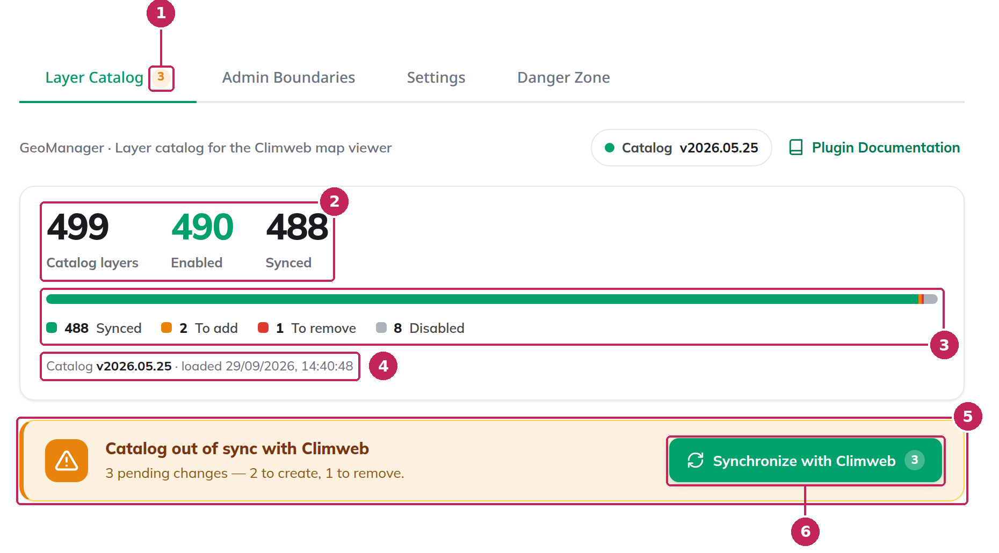
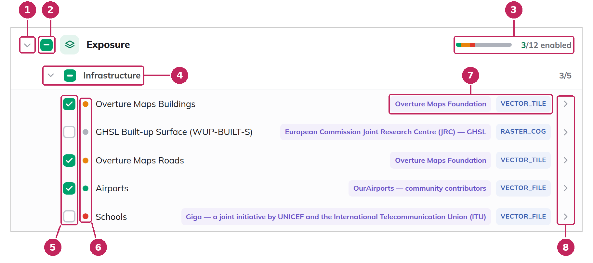
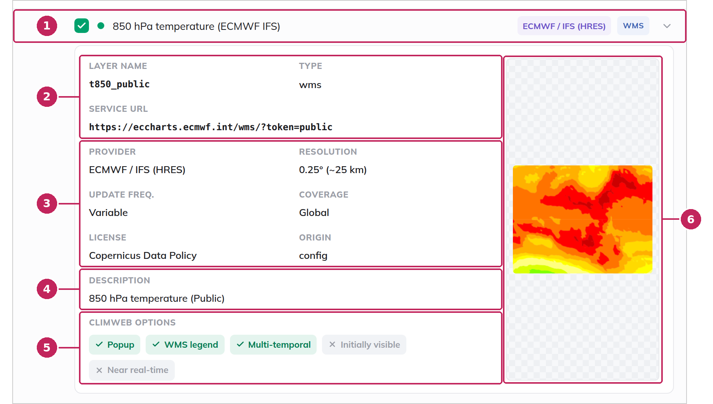
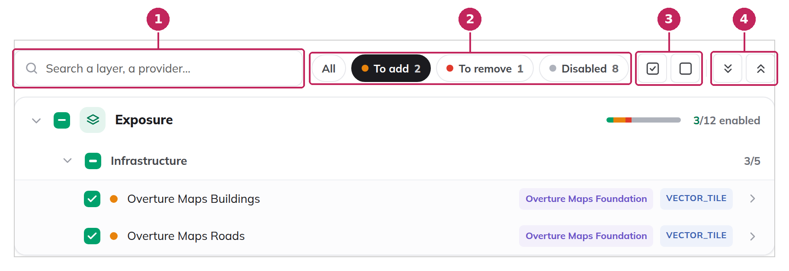
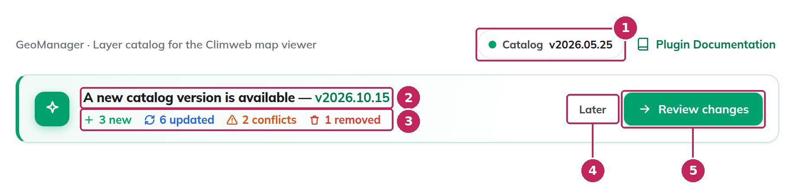
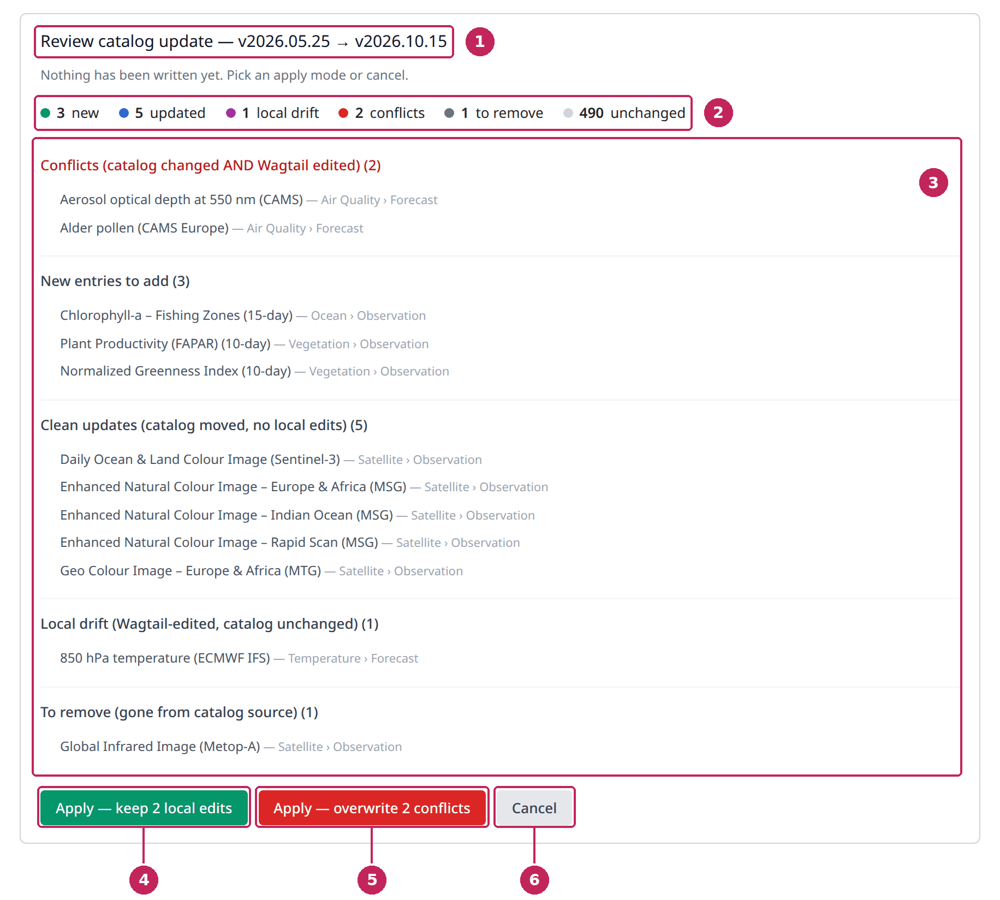

# The Layer Catalog

The **Layer Catalog** tab is the main screen of the [Dataset Helper](index.md). It lists the layers of the catalog, lets you choose the ones to publish in the MapViewer, and synchronizes your selection with ClimWeb.

---

## Load the catalog

The catalog is delivered with ClimWeb, but it is empty until you load it. As long as it is empty, the tab only shows the following message:


**1. Catalog version**: shows *not loaded* until the catalog is loaded, then the version of the loaded catalog, for example *v2026.05.25*.

**2. Load catalog**: loads the layers of the catalog, using the import language, the ECMWF token and the eStation URL of the [Settings](Settings.md).

Once loaded, all the layers are checked and have the *To add* status: they are ready to be published, but nothing has been created in the MapViewer yet. Uncheck the layers you do not need, then [synchronize with ClimWeb](#synchronize-with-climweb).

---

## Catalog status

The top of the tab summarises the state of the catalog and tells you whether ClimWeb is up to date with your selection.



**1. Pending changes**: the number on the **Layer Catalog** tab shows how many changes are waiting for synchronization.

**2. Counters**:

- **Catalog layers**: the total number of layers in the catalog.
- **Enabled**: the number of checked layers.
- **Synced**: the number of layers that are published in ClimWeb.

**3. Status bar**: shows how the layers are distributed between the four statuses: *Synced*, *To add*, *To remove* and *Disabled*. See [Layer status](#layer-status).

**4. Catalog version**: the version of the loaded catalog and the date it was loaded.

**5. Out-of-sync banner**: displayed when your selection differs from what is published in ClimWeb. It summarises the pending changes: the layers to create, to remove or to update. The banner is hidden when ClimWeb is up to date.

**6. Synchronize with Climweb**: applies the pending changes to ClimWeb. See [Synchronize with ClimWeb](#synchronize-with-climweb).

### Layer status

Each layer has a status, shown by a coloured dot in the layer tree:

| Dot | Status | Meaning |
| --- | --- | --- |
| Green | **Synced** | The layer is checked and published in ClimWeb. |
| Orange | **To add** | The layer is checked but not published yet. It will be created at the next synchronization. |
| Red | **To remove** | The layer is unchecked but is still published. It will be removed at the next synchronization. |
| Grey | **Disabled** | The layer is unchecked and not published. Nothing to do. |

Only a synchronization turns the orange and red statuses into green and grey.

---

## The layer tree

The layers are organised in a tree of categories and sub-categories. In the MapViewer, each category becomes a theme and each sub-category a sub-theme. When the page opens, all the categories are collapsed.



**1. Expand or collapse**: click a category to show or hide its sub-categories.

**2. Category checkbox**: checks or unchecks all the layers of the category at once. A dash means that only some of its layers are checked.

**3. Category summary**: a small status bar with the colours of the [layer statuses](#layer-status), followed by the number of enabled layers of the category.

**4. Sub-category**: click it to show or hide its layers. Its checkbox checks or unchecks all its layers at once, and the number on the right of the row is its number of enabled layers.

**5. Layer checkbox**: checks or unchecks the layer.

**6. Status**: the coloured dot shows the [status](#layer-status) of the layer.

**7. Provider and type**: the provider of the data and the [type of layer](#layer-types).

**8. Details**: click the layer row to open its details.

In this example, *Overture Maps Buildings* and *Overture Maps Roads* have just been checked and are waiting to be created (orange). *Airports* is already published (green). *Schools* has been unchecked but is still published, it will be removed at the next synchronization (red). *GHSL Built-up Surface* is neither checked nor published (grey).

### Layer details

Click a layer row to display its details. Click it again to close them.



**1. Layer row**: opens or closes the details of the layer.

**2. Layer name, type and service URL**: the identifier of the layer, its [type](#layer-types), and the address of the service the data comes from.

**3. Metadata**: the provider, resolution, update frequency, geographic coverage and license of the data, and the origin of the layer in the catalog. These metadata are copied to the dataset in ClimWeb and displayed in the [information window](../mapviewer/Browse-Data.md#data-layers) of the MapViewer.

**4. Description**: what the layer shows.

**5. Climweb options**: how the layer behaves in the MapViewer. The options in green are enabled:

- **Popup**: information is displayed when you click on the layer in the map.
- **WMS legend**: the legend is provided by the data source.
- **Multi-temporal**: the layer has several dates, which you can choose from the [date selector](../mapviewer/Legend.md#time-enabled-layers).
- **Initially visible**: the layer is displayed when the MapViewer opens.
- **Near real-time**: the layer is updated frequently with recent data.

**6. Preview**: for WMS layers, a preview of the layer on the whole world, requested from the data provider. *Preview not available* is displayed when the provider does not answer.

### Layer types

| Type | Description |
| --- | --- |
| **WMS** | Map images requested from a WMS service, for example ECMWF, EUMETSAT or eStation. Most layers of the catalog are of this type. |
| **Raster tile** | Ready-made map tiles of an image layer. |
| **Vector tile** | Ready-made tiles of a vector layer, such as roads or buildings. |
| **Raster COG** | Image files (Cloud Optimized GeoTIFF) read directly from the data provider. |
| **Raster file** | An image file downloaded from the data provider and stored in ClimWeb during the synchronization. |
| **Vector file** | Points, lines or areas, such as airports or schools, downloaded from the data provider and stored in ClimWeb during the synchronization. |

---

## Search and filter

The bar above the tree helps you find layers in a large catalog. Searching and filtering only change what is displayed: they do not change your selection.



**1. Search**: type a few words to keep only the layers whose name, identifier, provider, category or sub-category matches. The matching categories and sub-categories are expanded automatically. Click the cross, or press **Esc**, to clear the search.

**2. Status filters**: **All** shows all the layers. **To add**, **To remove** and **Disabled** only show the layers with that [status](#layer-status), with their number. In this example, the **To add** filter shows the two layers that will be created at the next synchronization: a quick way to review your changes before synchronizing.

**3. Select all layers / Deselect all layers**: checks or unchecks every layer of the catalog.

**4. Expand all / Collapse all**: opens or closes all the categories and sub-categories.

When nothing matches the search or the filter, the tree shows *No layer matches your search*. When you clear them, the tree goes back to the categories you had expanded.

---

## Choose the layers

To choose the layers to publish, use the checkboxes of the tree:

- the checkbox of a **layer** checks or unchecks this layer,
- the checkbox of a **sub-category** or of a **category** checks or unchecks all its layers,
- the **Select all layers** and **Deselect all layers** buttons of the [search bar](#search-and-filter) check or uncheck the whole catalog.

Your selection is saved immediately, and the statuses are updated: a layer that you check becomes *To add*, a published layer that you uncheck becomes *To remove*. The MapViewer is not modified until you [synchronize with ClimWeb](#synchronize-with-climweb), so you can prepare all your changes before publishing them.

---

## Synchronize with ClimWeb

When your selection differs from ClimWeb, the out-of-sync banner is displayed under the [catalog status](#catalog-status). Click **Synchronize with Climweb** to apply all the pending changes:

- for each layer **to add**, the Dataset Helper creates the dataset, its metadata and its layer in the Geo Manager, in the category and sub-category of the catalog. If a category or a sub-category with the same name already exists, the dataset is added to it.
- for each layer **to remove**, the dataset and its metadata are deleted. The category and the sub-category are kept, even if they no longer contain any dataset.
- for each layer that is **already synced**, the dataset is updated if the content of the layer has changed in the catalog, for example after a [catalog update](#catalog-updates).

The synchronization can take some time, in particular for the *Raster file* and *Vector file* layers, whose data is downloaded and stored in ClimWeb. When it is complete, a message summarises what has been done, in place of the out-of-sync banner:


**1. Result**: the number of layers added, removed and updated. When a layer could not be created or removed, for example because its data provider did not answer, a warning lists it below the message. It keeps its status, and you can run the synchronization again later.

**2. Close**: hides the message.

The layers are now available in the MapViewer. You can change your selection and synchronize again at any time: only the differences are applied.

```{note}
To remove a layer from the MapViewer, uncheck it in the Dataset Helper and synchronize, rather than deleting its dataset in the Geo Manager. If you delete it in the Geo Manager, the Dataset Helper notices it at the next synchronization (counted as *orphans cleared*) and the layer goes back to the *To add* status. It is then created again at the following synchronization, unless you uncheck it.
```

---

## Catalog updates

A new version of ClimWeb can come with a new version of the catalog, with new layers, improved descriptions or new addresses for existing layers. When the catalog delivered with ClimWeb is more recent than the one you have loaded, a banner is displayed at the top of the tab:



**1. Loaded version**: the version of the catalog that is currently loaded.

**2. New version**: the version of the catalog delivered with ClimWeb.

**3. Summary of the changes**: the number of new, updated, conflicting and removed layers.

**4. Later**: hides the banner until you reload the page.

**5. Review changes**: opens the list of changes, so you can check them before applying them.

### Review the changes

Reviewing the changes does not modify anything: you can open the review and cancel it as many times as you need.



**1. Versions**: the loaded version and the new version of the catalog.

**2. Summary**: the number of layers in each group of changes.

**3. Changes**: the layers of each group, with their category and sub-category. Click the title of a group to show or hide its layers.

| Group | Meaning |
| --- | --- |
| **Conflicts** | The layer has changed in the new catalog, and its dataset has also been edited in the Geo Manager. You have to choose which version to keep. |
| **New entries** | The layer is new in the catalog. |
| **Clean updates** | The layer has changed in the new catalog, and its dataset has not been edited in the Geo Manager. The update can be applied safely. |
| **Local drift** | The dataset of the layer has been edited in the Geo Manager, but the layer has not changed in the catalog. Your changes are kept. |
| **To remove** | The layer is no longer in the new catalog. |
| **Unchanged** | Nothing has changed. |

**4. Apply — keep local edits**: applies all the changes except the conflicts. The datasets you have edited in the Geo Manager are kept as they are. When there is no conflict, this button is simply named **Apply changes**.

**5. Apply — overwrite conflicts**: applies all the changes, including the conflicts. At the next synchronization, the changes you have made to these datasets in the Geo Manager are replaced by the content of the new catalog. This button is only displayed when there are conflicts.

**6. Cancel**: closes the review without changing anything.

### After applying the update

Applying the update changes the catalog, but not the MapViewer yet:

- the **new** layers are added to the tree with the *To add* status,
- the **removed** layers are unchecked: if they are published, their status becomes *To remove*,
- the **updated** layers that are published are counted as *to update* in the out-of-sync banner.

Click **Synchronize with Climweb** to apply these changes to the MapViewer. Until then, the MapViewer keeps the previous version of the layers.

```{note}
The *Raster file* layers are not updated automatically by the synchronization, to avoid deleting the data already stored in ClimWeb. They are reported as *raster_file drift (skipped)* in the result of the synchronization. To apply the new version of such a layer, uncheck it and synchronize to remove it, then check it again and synchronize to create it again.
```
