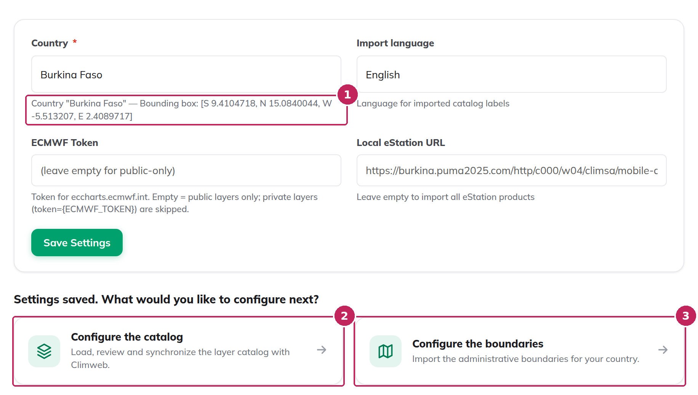

# Settings

The **Settings** tab of the [Dataset Helper](index.md) contains its settings for your ClimWeb instance. The country is required: until it is saved, the Layer Catalog, Admin Boundaries and Danger Zone tabs are locked.


**1. Locked tabs**: the other tabs are greyed out and cannot be opened until the required settings are saved.

**2. Required settings**: this message is displayed as long as the country has not been saved.

**3. Country** (required): the country of your institution. When you choose it, its official name and its bounding box are retrieved from OpenStreetMap and displayed below the list. The country is used to download the data of your country for the layers that need it, such as population, schools or airports, and to import its [administrative boundaries](Admin-Boundaries.md).

**4. Import language**: the language of the names and descriptions of the layers: English, French, Spanish, Portuguese or Arabic. The language is applied when the catalog is loaded.

**5. ECMWF Token**: some ECMWF layers are only available with an ECMWF access token. Leave the field empty to load only the public ECMWF layers: the other ones are skipped. When a token is entered, these layers are also loaded, and their datasets are created as non-public datasets, reserved for the users logged in to the MapViewer.

**6. Local eStation URL**: if your institution runs its own eStation, enter its address. Only the eStation products that are available on your eStation are then loaded, and they are served by your eStation. Leave the field empty to load all the eStation products of the catalog.

**7. Save Settings**: saves the settings. Saving the settings does not change anything in the MapViewer.

```{note}
The import language, the ECMWF token and the eStation URL are applied when the catalog is loaded. Fill them in before loading the catalog: changing them later does not modify the layers that are already in the catalog. To apply new settings to these layers, use [Reset Catalog](Danger-Zone.md#reset-catalog) and load the catalog again.
```

Once the settings are saved, the other tabs are unlocked and two shortcuts are displayed below the form:



**1. Country information**: the official name and the bounding box of the selected country.

**2. Configure the catalog**: opens the [Layer Catalog](Layer-Catalog.md) tab.

**3. Configure the boundaries**: opens the [Admin Boundaries](Admin-Boundaries.md) tab.
