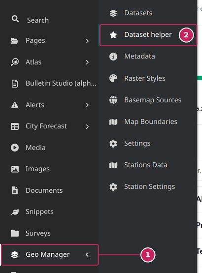
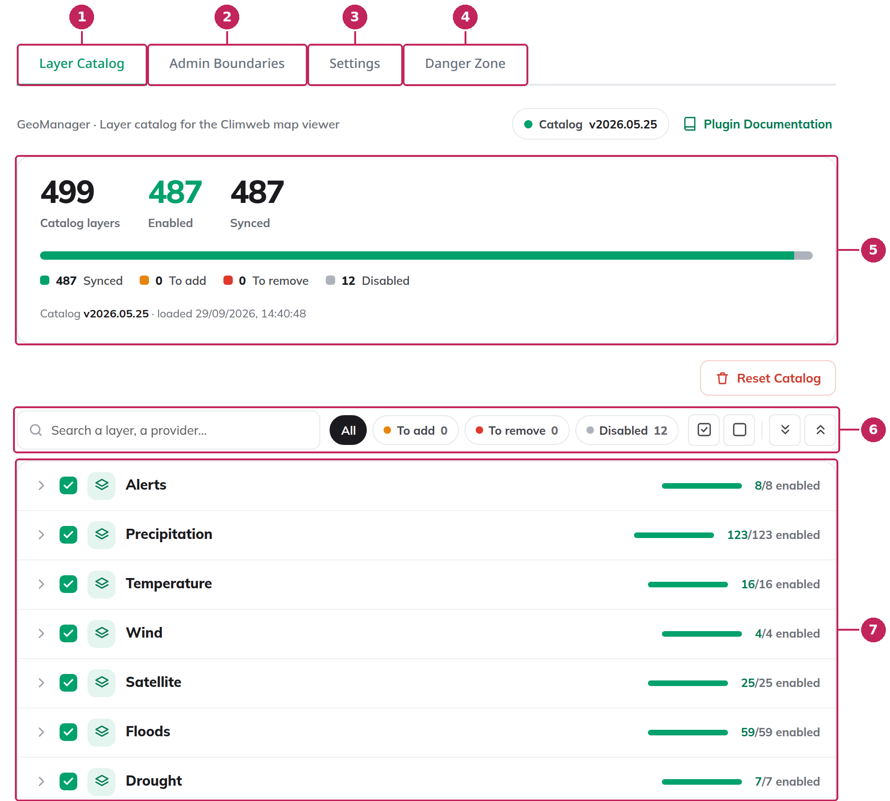

# Dataset Helper

The Dataset Helper fills your [MapViewer](../mapviewer/index.md) with data layers in a few clicks. It comes with a ready-to-use catalog of several hundred layers from regional and global data providers, such as ECMWF, EUMETSAT, Copernicus, the JRC eStation products, WorldPop or Overture Maps. The layers are organised into categories, such as Precipitation, Temperature, Floods or Air Quality. You choose the layers you want with checkboxes, and the Dataset Helper creates the matching datasets in the Geo Manager for you, with their metadata, legend and display options. It can also import the administrative boundaries of your country.

**New to the Dataset Helper?** Follow the [Get started](Get-Started.md) guide to publish your first layers in three steps: settings, catalog loading and synchronization.

The screenshots in this guide come from a ClimWeb instance configured for Burkina Faso. The number of layers and the version of the catalog on your own instance depend on its settings and on the version of ClimWeb.

```{note}
The Dataset Helper creates and deletes datasets of the MapViewer. It is meant for the administrators in charge of the MapViewer.
```

---

## Open the Dataset Helper

In the ClimWeb admin, click **Geo Manager** in the main menu, then **Dataset helper**.



**1. Geo Manager**: opens the Geo Manager menu.

**2. Dataset helper**: opens the Dataset Helper.

The first time you open it, the Dataset Helper shows the **Settings** tab: the other tabs stay locked until you have chosen your country. See [Settings](Settings.md).

---

## Overview



**1. Layer Catalog**: the main screen. Choose the layers to publish in the MapViewer, then synchronize them with ClimWeb. See [The Layer Catalog](Layer-Catalog.md).

**2. Admin Boundaries**: imports the administrative boundaries of your country from OCHA. See [Admin Boundaries](Admin-Boundaries.md).

**3. Settings**: the country and the options of the Dataset Helper. They must be completed before you can use the other tabs. See [Settings](Settings.md).

**4. Danger Zone**: actions that delete datasets in bulk. See [Danger Zone](Danger-Zone.md).

**5. Catalog status**: the number of layers in the catalog, how many are enabled and how many are already published in ClimWeb. See [Catalog status](Layer-Catalog.md#catalog-status).

**6. Search and filters**: find a layer by its name or provider, or show only the layers that are waiting for synchronization. See [Search and filter](Layer-Catalog.md#search-and-filter).

**7. Layer tree**: the layers of the catalog, organised by category and sub-category, each with a checkbox to enable or disable it. See [The layer tree](Layer-Catalog.md#the-layer-tree).

---

## How it works

The Dataset Helper keeps its own list of layers, the **catalog**, next to the datasets of the Geo Manager. Publishing layers in the MapViewer always takes two steps:

1. **Select**: in the Layer Catalog, check the layers you want to publish and uncheck the others. This only changes your selection: the MapViewer is not modified yet.
2. **Synchronize**: click **Synchronize with Climweb**. The Dataset Helper creates the datasets of the checked layers in the Geo Manager, and deletes the datasets of the layers you have unchecked. The MapViewer is now up to date.

In the MapViewer, each category of the catalog becomes a [theme](../mapviewer/Browse-Data.md#themes) and each sub-category a [sub-theme](../mapviewer/Browse-Data.md#sub-themes). For example, the layers of *Temperature › Forecast* are displayed in the *Temperature* theme, under the *Forecast* sub-theme.

The datasets created by the Dataset Helper are regular Geo Manager datasets: you can find them, and edit them if needed, under **Geo Manager → Datasets**. The datasets you have created yourself in the Geo Manager are never modified or deleted by the Dataset Helper, except by the last action of the [Danger Zone](Danger-Zone.md#clear-all-datasets-and-categories).

### Getting started

The first time you use the Dataset Helper, follow the [Get started](Get-Started.md) guide: it takes you through the settings, the loading of the catalog and the synchronization with ClimWeb.

---

```{toctree}
---
maxdepth: 1
---
Get-Started
Settings
Layer-Catalog
Admin-Boundaries
Danger-Zone
```
