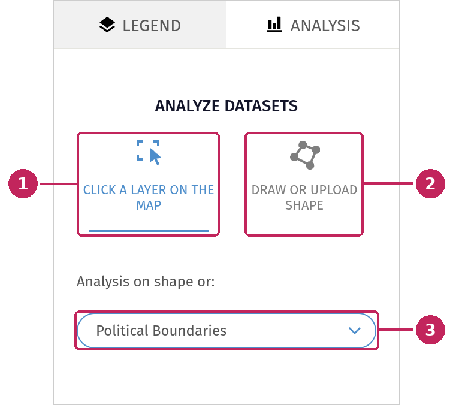
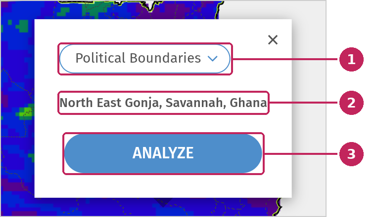
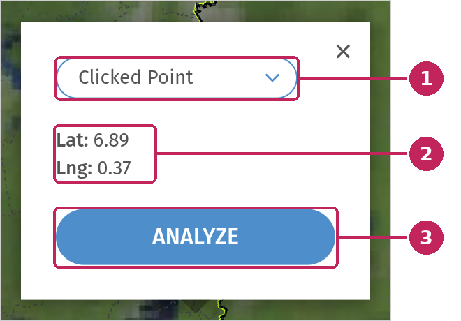
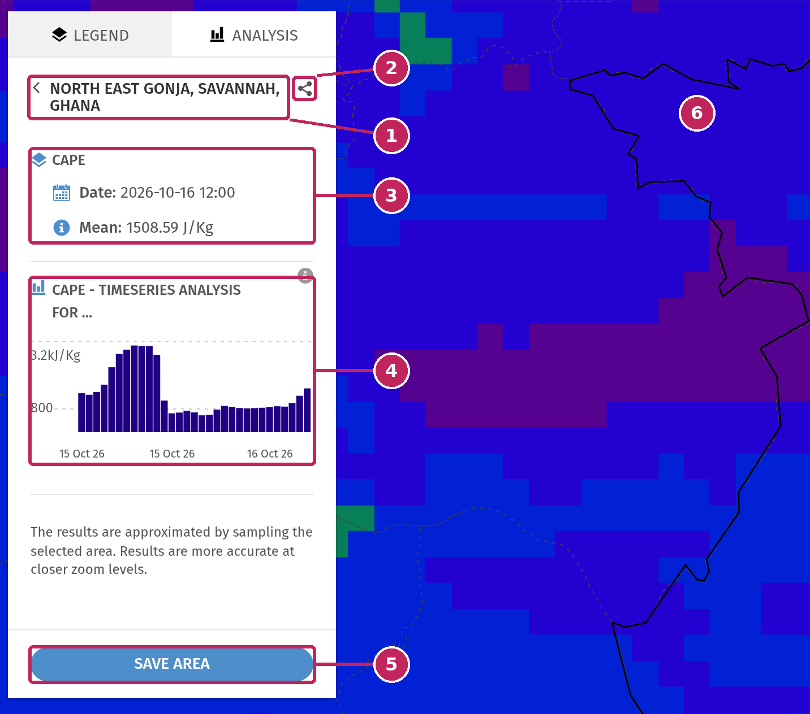
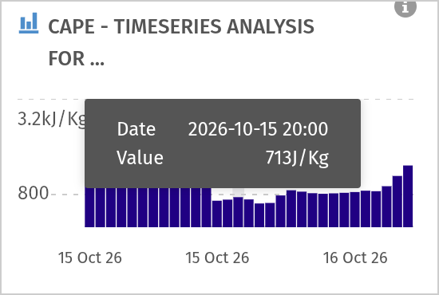
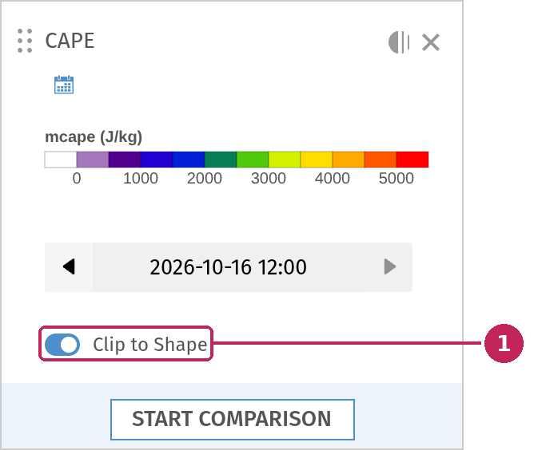
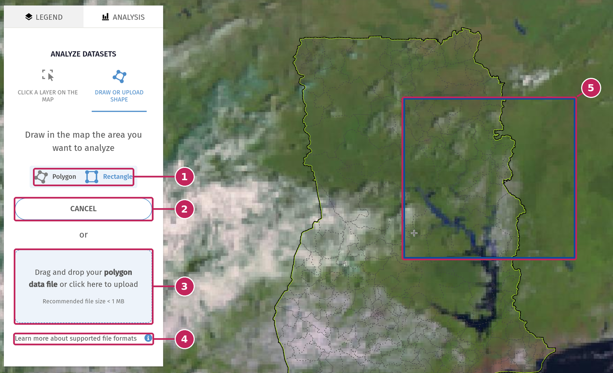

# Analysis

The **Analysis** tab of the Legend panel gives you the values of the layers displayed on the map over an area of your choice: an administrative area such as a region or a district, a single point, a shape that you draw on the map, or a file that you upload. For each layer, you get the values at the date displayed on the map and a chart of their evolution over time.

Only the layers for which your administrators have configured an analysis are analysed. The other layers stay on the map but are ignored. When none of the displayed layers can be analysed, the tab shows the message *Select a data layer to analyze.*

> Administrators configure the analysis of a raster file layer in the Geomanager, with the **Point Analysis** and **Area Analysis** blocks of its **Analysis** field: the value to display (mean, sum, minimum and maximum, or minimum, mean and maximum), the unit, and the type and colour of the time series chart.

---

## Choose an area

Open the **Analysis** tab at the top of the Legend panel. The tab first asks you how you want to select the area to analyse.

**1. CLICK A LAYER ON THE MAP**: select an area by clicking it on the map, for example a district.

**2. DRAW OR UPLOAD SHAPE**: draw your own area on the map, or upload a file. See [Draw or upload a shape](#draw-or-upload-a-shape).

**3. Boundaries**: choose the boundaries displayed on the map that you can click: the administrative boundaries (*Political Boundaries*), or other areas provided by your administrators.

The analysis is not available while you compare two maps. Click **Exit comparison** in the Analysis tab to go back to a single map.

### Analyse an administrative area

Click inside an area on the map. A window opens with the name of the area:

**1. Type of selection**: the boundaries you clicked. Select *Clicked Point* to analyse the exact point that you clicked instead of the whole area.

**2. Area**: the name of the area that you clicked, with the larger areas it belongs to.

**3. ANALYZE**: starts the analysis. The map zooms to the area and the results are displayed in the Analysis tab.

### Analyse a point

Click the map at the place you want to analyse, then select *Clicked Point* in the list at the top of the window.

**1. Clicked Point**: analyse the point that you clicked.

**2. Coordinates**: the latitude and longitude of the point.

**3. ANALYZE**: starts the analysis. The results show the value of each layer at this point, instead of statistics over an area.

---

## Read the results

**1. Area**: the name of the analysed area. Click the arrow to go back and choose another area.

**2. Share**: copy a link to this analysis, to send it by email or instant messaging.

**3. Values at the displayed date**: for each layer, the date currently displayed on the map and the values over the area. Depending on the layer, you get the mean, the sum, the minimum and maximum, or the minimum, mean and maximum of the values in the area. For a point, you get the value at the point.

**4. Time series**: a chart of the values of the layer for all its available dates. For an area, each bar is the mean or the sum of the values over the area at that date.

**5. SAVE AREA**: saves the area to your Areas of Interest, so that you can find it again later. You need to be logged in: if you are not, the login window opens.

**6. Analysed area**: the area is outlined on the map, and the map zooms to it.

Hover the bars of the chart to display the date and the value of each time step:

When several layers can be analysed, each of them has its own values and its own chart. If you change the date of a layer in the legend, its values are updated for the new date.

When the map is zoomed out, a message reminds you that the results are approximated by sampling the area, and that they are more accurate at closer zoom levels.

### Show the data only in the area

When an area is analysed, a **Clip to Shape** switch is displayed in the legend of the layers that support it.

**1. Clip to Shape**: switch it on to display the layer only inside the analysed area. Switch it off to display the whole layer again.

> Administrators enable or disable clipping for a dataset with the **Enable Clipping by shape** setting in the Geomanager.

---

## Draw or upload a shape

Select **DRAW OR UPLOAD SHAPE** to analyse an area that does not match the boundaries of the map: a river basin, a farming area, the area hit by a storm, etc.

**1. Shape**: choose to draw a **Polygon** or a **Rectangle**.

**2. START DRAWING**: click it, then draw the shape on the map. While you draw, the button becomes **CANCEL**, to stop drawing.

**3. Upload**: drag and drop a file in this area, or click it to choose a file on your computer. The recommended file size is less than 1 MB.

**4. Supported file formats**: click the **i** button to display the list of supported formats.

**5. Shape on the map**: the shape being drawn.

To draw a shape:

- **Rectangle**: click a first corner on the map, move the mouse, then click the opposite corner.
- **Polygon**: click on the map to add each point of the polygon. To finish, click the first point again, or double-click the last point.

The analysis starts as soon as the shape is finished. The results are displayed in the same way as for an administrative area, under the name *Custom drawn area*.

The uploaded file must contain polygons only (no points or lines), in a single layer. The supported formats are:

- `.geojson`, `.json`, `.kml` and `.kmz` files,
- `.csv` files, with a column containing the shapes in Well-Known Text (WKT) format,
- zipped shapefiles (`.zip`), including the `.shp`, `.shx`, `.dbf` and `.prj` files.
