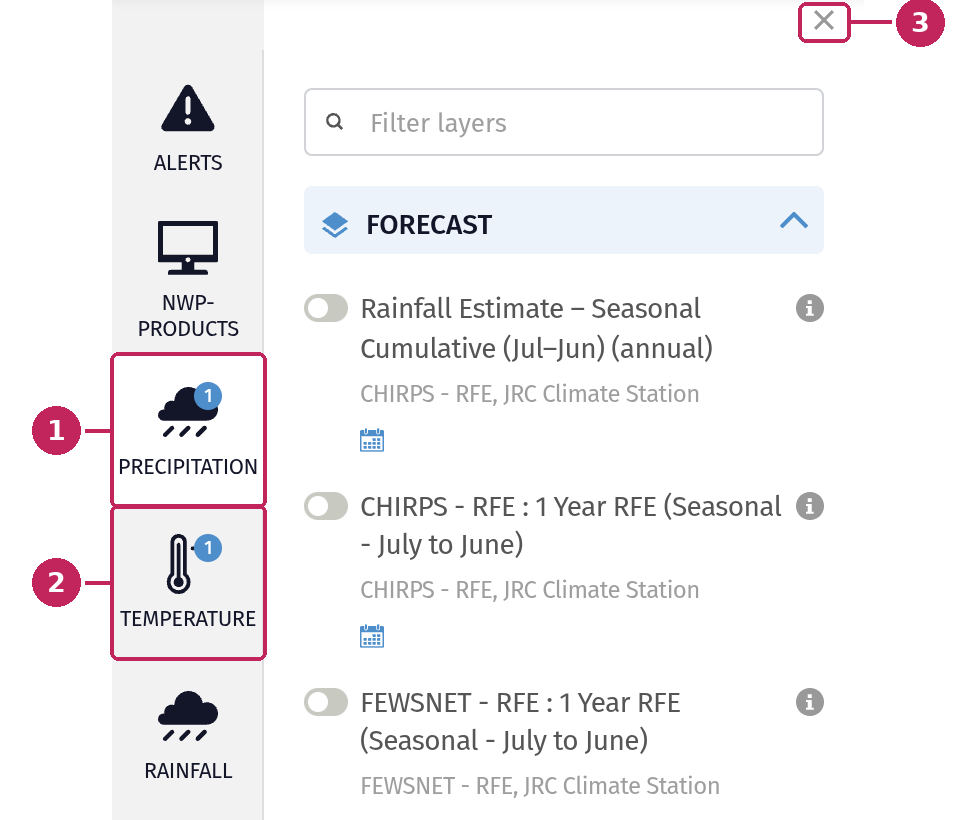
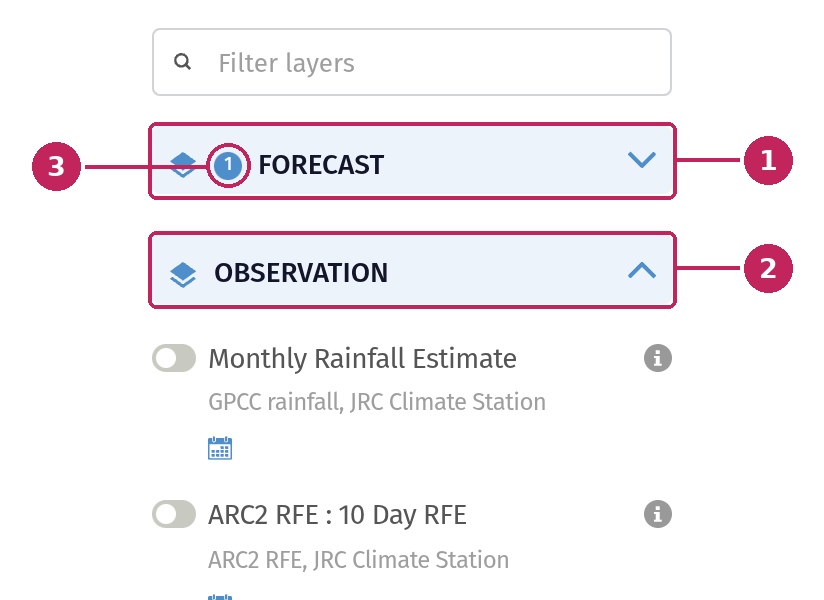
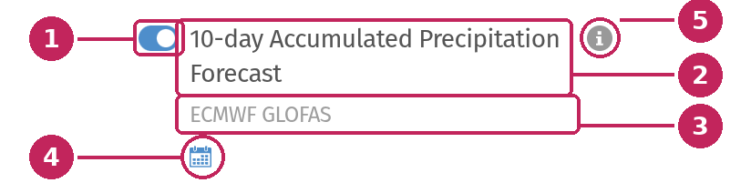
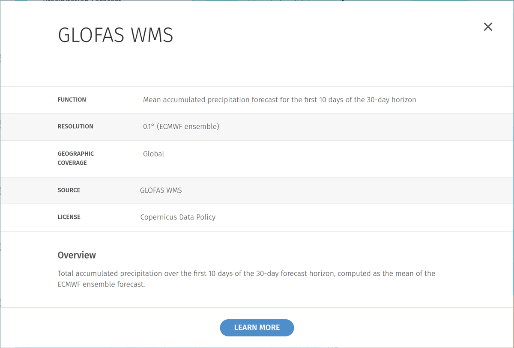
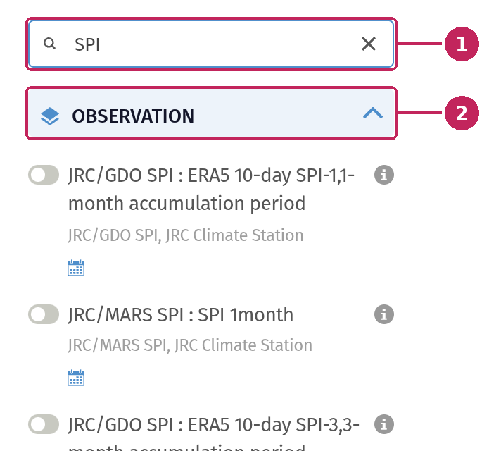

# Browse and select data

All the data available in the MapViewer is organised in three levels:

- **Themes**: the main families of data, displayed as icons on the left of the map.
- **Sub-themes**: groups of related layers within a theme, for example *Forecast* and *Observation*.
- **Data layers**: the datasets themselves, which you can display on the map.

## Themes

The themes are listed in the vertical menu on the left side of the map. Each theme has an icon and a name. If there are more themes than can fit on your screen, scroll down the menu to see them all.

**1. Selected theme**: click a theme to open the data panel and browse its sub-themes and data layers. The selected theme is highlighted.

**2. Number of active layers**: a blue badge on a theme icon shows how many of its layers are currently displayed on the map. This helps you find your active layers when you have combined data from several themes.

**3. Close the panel**: click the cross, or click the selected theme again, to close the data panel and free up space on the map. Closing the panel does not remove the layers from the map.

## Sub-themes

Within a theme, data layers are grouped into sub-themes. Each sub-theme has a header with its name that you can click to collapse or expand its list of layers.

**1. Collapsed sub-theme**: click the header of a sub-theme to hide its layers. This is useful to quickly reach the other sub-themes when a theme contains many layers.

**2. Expanded sub-theme**: click the header again to show its layers.

**3. Number of active layers**: when a sub-theme is collapsed, a blue badge shows how many of its layers are displayed on the map.

Some sub-themes also display a set of options above their layers. Click an option to show the layers of the corresponding group.

## Data layers

Each data layer is presented with its name, its source and a set of tools.

**1. Toggle**: switch the layer on to display it on the map, or off to remove it. You can also click the name of the layer. Once switched on, the layer is added to the legend, where you can adjust its settings.

**2. Name**: the title of the data layer.

**3. Source**: a short description of the layer, usually its data source or provider.

**4. Capabilities**: icons showing what you can do with the layer. Hover an icon to display its meaning:

- **Supports Time** (calendar icon): the layer has several dates or time steps. You can choose the date to display from the [legend](Legend.md#time-enabled-layers).
- **Near Real Time**: the layer is updated frequently with recent data.

**5. Information**: click the **i** button to open the description of the layer.

The information window describes the data layer: what it shows, its resolution, geographic coverage, source and license, followed by an overview of the data. When available, the **LEARN MORE** button takes you to more information about the data.

You can display several layers at the same time, from the same theme or from different themes. For example, you can combine a precipitation forecast with a temperature layer, or overlay observations on top of a forecast. The order and the transparency of the layers can then be adjusted from the [legend](Legend.md#layers-in-the-legend).

## Filter layers

Some themes contain many data layers. To quickly find a layer, type a few words in the **Filter layers** field at the top of the data panel.

**1. Filter field**: the list is filtered as you type, on the name and description of the layers. Click the cross, or press **Esc**, to clear the filter.

**2. Matching sub-themes**: only the sub-themes that contain matching layers are kept. In this example, all the layers matching *SPI* (Standardized Precipitation Index) belong to the *Observation* sub-theme.

The filter only applies to the selected theme. To search for data across all themes, use the search bar in the header.
