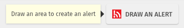
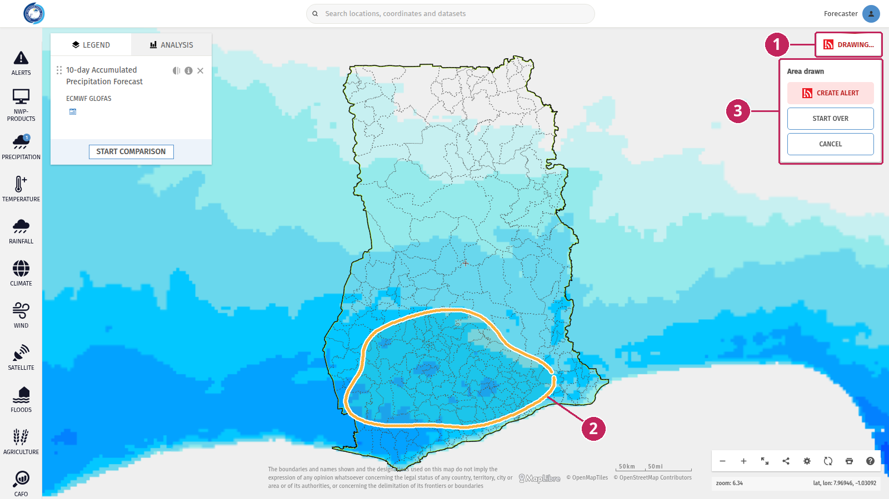
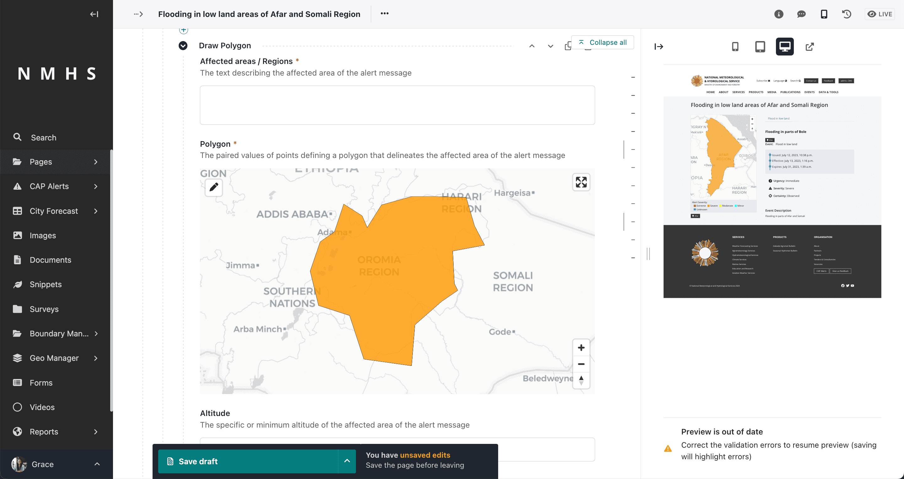

# Create an alert from the map

Forecasters can draw an area on the MapViewer and use it to create a CAP alert. You define the alert area while looking at the forecasts and observations, for example around the zone where heavy rainfall is expected. The area is then sent to the CAP Composer, which opens a new alert with the area already filled in.

---

## Before you start

The **DRAW AN ALERT** button is only displayed when:

- you are logged in to the MapViewer. See [Logging in](Header.md#logging-in).
- the CAP Composer is installed on your website.

To create the alert itself, you also need:

- to be logged in to the administration interface of your website, in the same browser,
- the permission to create CAP alerts. See [CAP Composer and Approver Roles](../manage_cap/Composer-and-Approver.md).

```{note}
Logging in to the MapViewer does not log you in to the administration interface. If you are not logged in to it when you click **CREATE ALERT**, the new tab shows the login page, and the alert form opens without the area once you have logged in. In this case, go back to the MapViewer and draw the area again.
```

---

## Draw the area

1. Display the layers you need to decide on the alert area, for example a precipitation forecast. See [Browse and select data](Browse-Data.md).

2. Click **DRAW AN ALERT** in the top-right corner of the map.



3. Click on the map and keep the mouse button pressed, then drag the mouse around the area. The map doesn't move while you draw. Release the mouse button to close the area.



**1. DRAWING…**: shows that the drawing mode is on. Click it again to stop drawing and remove the area.

**2. Drawn area**: the outline of the area that will be used in the alert.

**3. Area drawn**: once the area is closed, a popup offers three actions:

- **CREATE ALERT**: opens a new alert with this area in a new tab of your browser. See [Complete the alert](#complete-the-alert).
- **START OVER**: removes the area so you can draw it again.
- **CANCEL**: removes the area and stops the drawing mode.

```{note}
Drawing an alert area and drawing a shape in the [Analysis](Analysis.md) tab can't be done at the same time. Clicking **DRAW AN ALERT** stops the analysis drawing and closes the Analysis tab.
```

---

## Complete the alert

**CREATE ALERT** opens the page to add a new CAP alert in the administration interface, in a new tab. Nothing is saved at this point: the MapViewer only fills in the area of the alert.

The alert contains one **Alert Information** block. In its **Area** section, a **Draw Polygon** area holds the area you drew on the map.



The **Affected areas / Regions** field is empty: describe the area covered by the alert, for example the names of the regions or districts.

Then fill in the rest of the alert as usual, and save it as a draft or submit it for approval. See [Creating CAP Alerts](../manage_cap/Creating-Alerts.md).

You can still change the area in the alert form: move the points of the polygon on the map, or add other areas.
