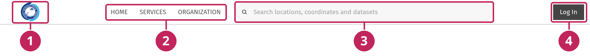
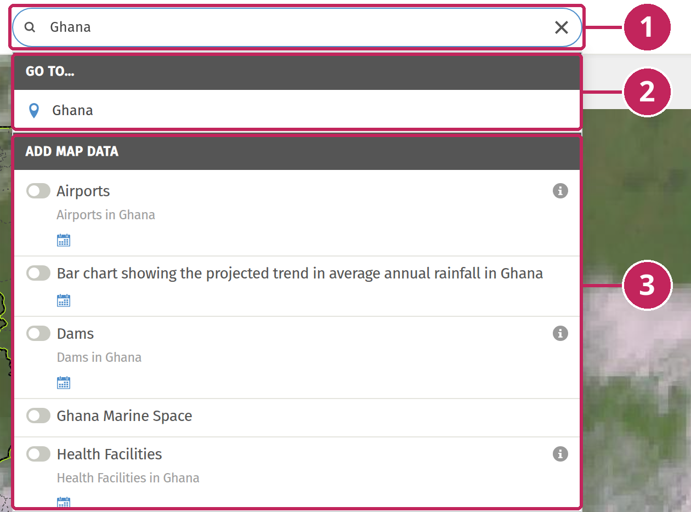
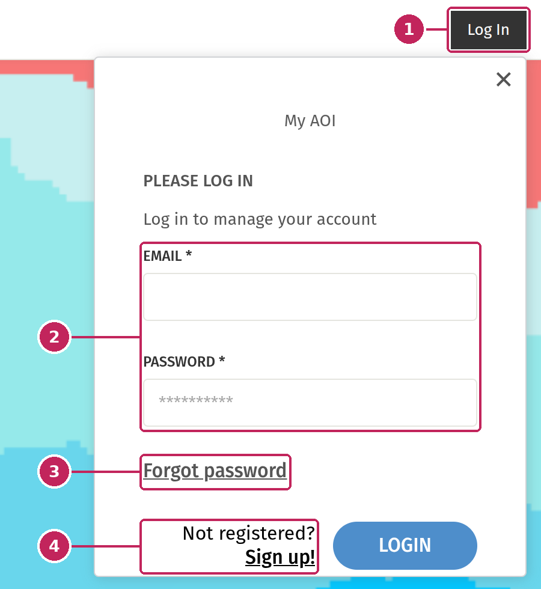

# The header

The header runs along the top of the MapViewer and stays visible at all times.



**1. Organisation logo**: takes you back to the organisation website. See [Organisation logo](#organisation-logo).

**2. Navigation links**: links to other pages of the website. See [Navigation links](#navigation-links).

**3. Search bar**: finds a place, goes to coordinates or looks up a dataset. See [Search](#search).

**4. Log in**: gives access to your account and to data reserved for registered users. See [Logging in](#logging-in).

---

## Organisation logo

The logo of your organisation is displayed in the top-left corner of the header. Click it to leave the map and go to the page chosen by your administrators, usually the home page of the organisation website.

## Navigation links

Depending on the configuration, a few links to other pages of the website are displayed next to the logo. On small screens, they are grouped in a menu that opens with the menu button.

> Administrators set the logo, the page it links to and the navigation links in the **Geomanager Settings**, under the **Navigation Settings** tab.

## Search

The search bar in the centre of the header finds places, coordinates and datasets. Start typing: the results are listed below the search bar as you type.



**1. Search bar**: type the name of a place, coordinates, or words from the name of a dataset. Click the cross to clear the search.

**2. GO TO…**: the places that match your search. Click a place to zoom the map to it. See [Search for a place](#search-for-a-place).

**3. ADD MAP DATA**: the datasets that match your search. See [Search for data](#search-for-data).

When nothing matches, the list shows *No results*.

### Search for a place

Type the name of a city, a region, a river or any other place. Places are found in [OpenStreetMap](https://www.openstreetmap.org), and are displayed in the language of your browser.

The search gives priority to the places in your country: they are listed first. Places elsewhere in the world can also be listed, for example when no place in your country matches your search. Up to 10 places are listed.

Click a place to zoom the map to it. A popup opens on the map with the full name of the place and an **ANALYZE** button, to analyse the data displayed on the map over this place. See [Analysis](Analysis.md).

> The country used to prioritise the results is the one selected by your administrators in the **Boundary settings** of the Geo Manager. See [Setting Boundaries](../manage_cap/Setting-Boundaries.md).

### Go to coordinates

Type the latitude and longitude of a point. Instead of places and datasets, the list then shows a single **GO TO COORDINATE** result. Click it to zoom the map to the point. A popup opens with the coordinates of the point and an **ANALYZE** button. See [Analyse a point](Analysis.md#analyse-a-point).

Two formats are accepted:

- **Decimal degrees**, latitude first, separated by a comma or a space, for example `6.6885, -1.6244`. Use a minus sign for latitudes south of the Equator and longitudes west of Greenwich.
- **Degrees, minutes and seconds**, with the `N` and `E` letters, for example `6° 36' 3"N 0° 28' 17"E`.

```{note}
Degrees, minutes and seconds are only recognised for latitudes north of the Equator (`N`) and longitudes east of Greenwich (`E`). For other locations, use decimal degrees.
```

### Search for data

The search also looks up the datasets of the MapViewer, in all the themes. A dataset is listed when its name or its description contains the text you typed. Upper and lower case and accents are ignored. Up to 10 datasets are listed.

Each dataset in the list works as in the [data panel](Browse-Data.md#data-layers):

- use the toggle to add the layer to the map, or to remove it. Added layers are listed in the [Legend panel](Legend.md).
- click the information icon to read the description of the layer.

This is the fastest way to find a dataset when you don't know in which theme it is.

## Logging in

You don't need an account to use the MapViewer: all public data can be viewed without logging in. Logging in gives access to:

- data layers that your organisation has reserved for registered users,
- your **Areas of Interest (AOI)**: areas you have saved to analyse them again later.

To log in, click **Log In** in the top-right corner of the header. A login window opens:



**1. Log In button**: opens or closes the login window.

**2. Email and password**: enter the email address and password of your account, then click **LOGIN**.

**3. Forgot password**: enter your email address to receive instructions to reset your password.

**4. Sign up**: create a new account. A confirmation email is sent to activate it.

Once you are logged in, the **Log In** button is replaced by your name and avatar. Click them to open your account menu, where you can view your profile, find your saved Areas of Interest and log out.

```{note}
The login button is only displayed if your administrators have enabled user accounts, and the **Sign up** link only if they allow visitors to create their own account. Both options are available in the **Geomanager Settings**, under the **My Account Settings** tab.
```
