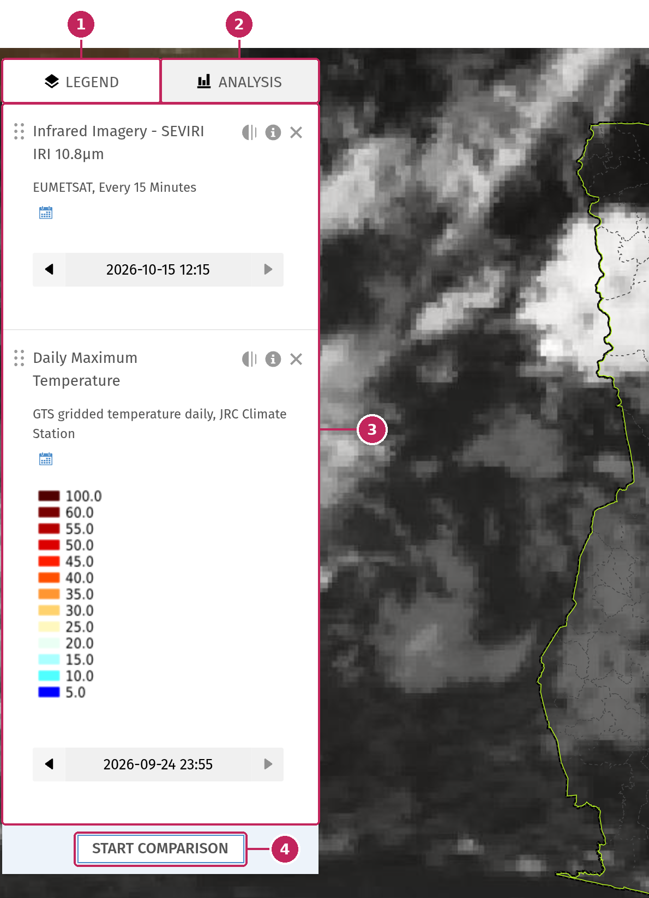
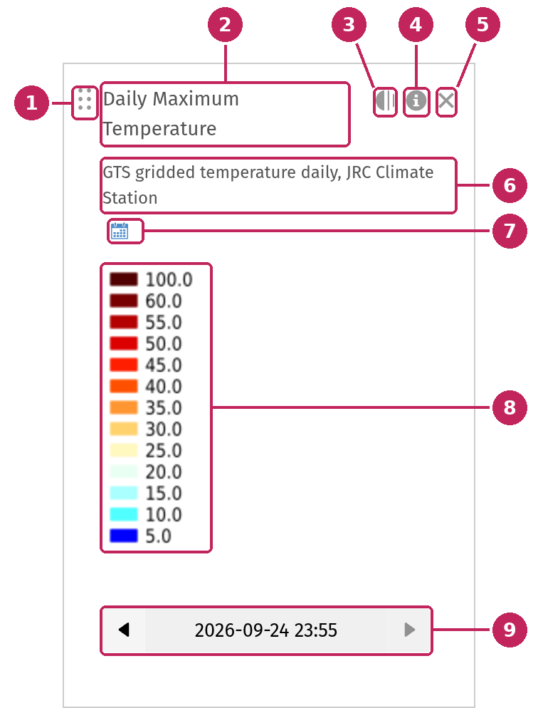
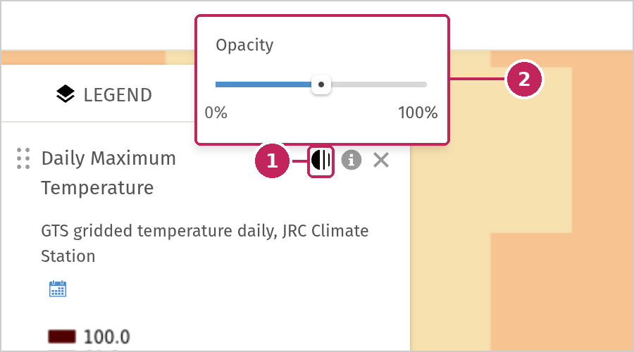
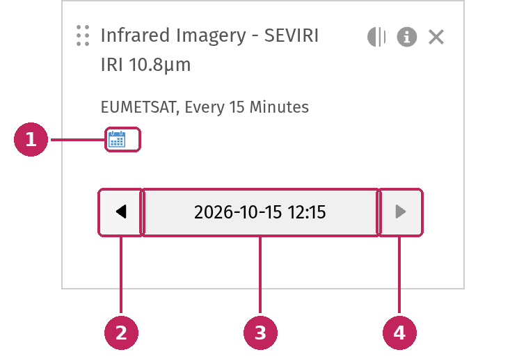
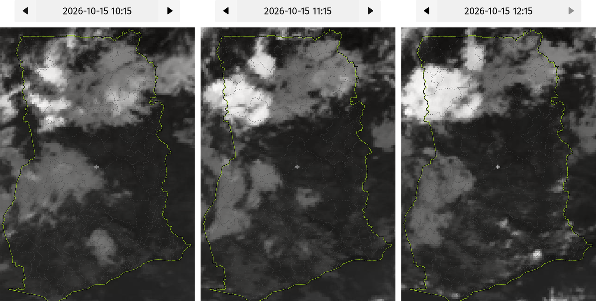
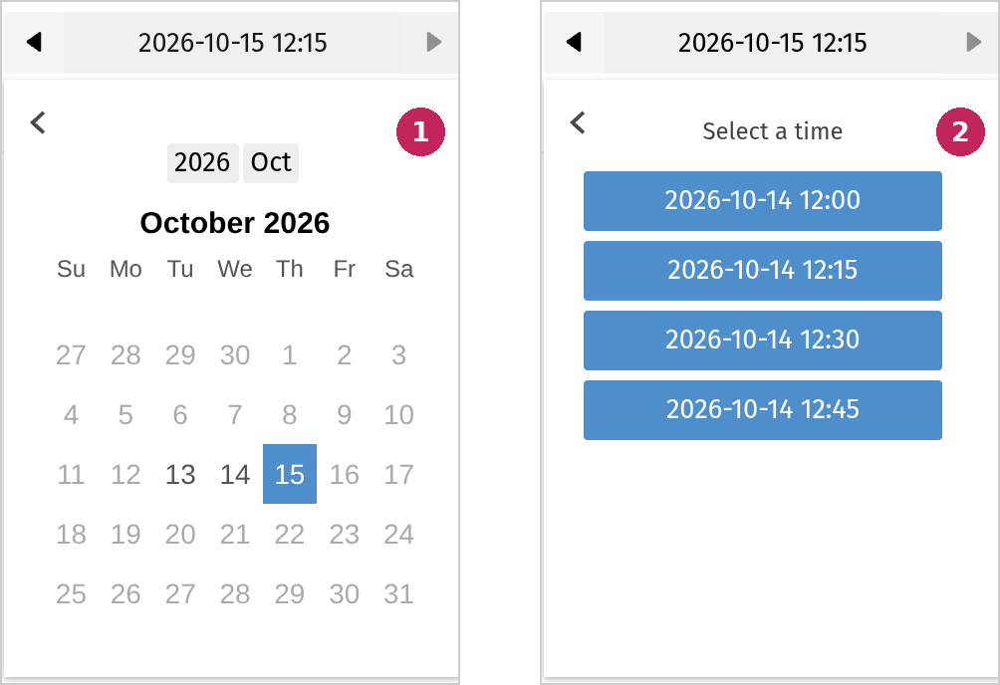
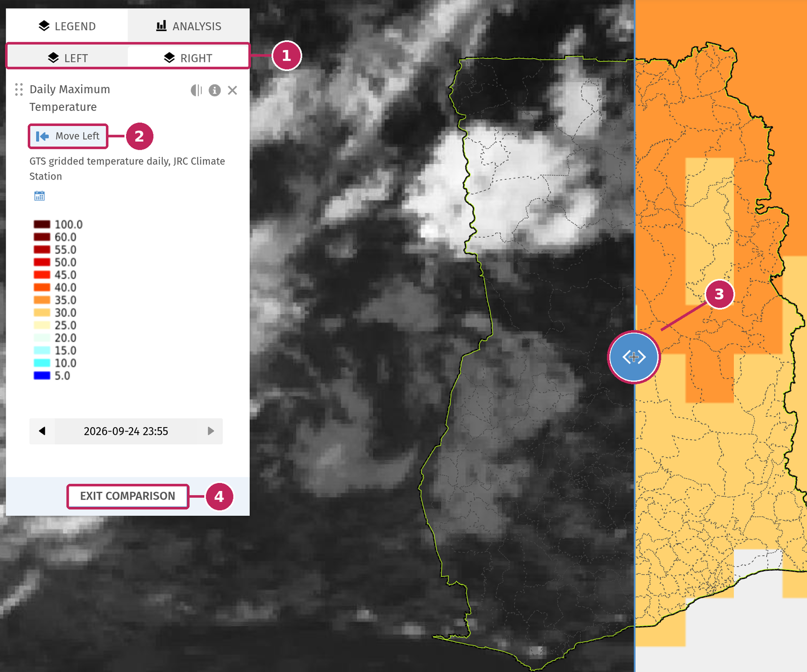

# The Legend panel

Once you have switched on data layers from the [data panel](Browse-Data.md), they are listed in the **Legend** panel, at the top left of the map. This is where you read the legend of each layer, choose the date to display, adjust the transparency and the order of the layers, and compare two maps side by side.



**1. LEGEND tab**: lists the layers displayed on the map. Click the tab when it is already selected to collapse the panel and see more of the map. Click it again to expand the panel.

**2. ANALYSIS tab**: lets you analyse the data of the layers over an area. See [Analysis](Analysis.md).

**3. Layers on the map**: each layer displayed on the map has its own card in the list. The layer at the top of the list is drawn above the others on the map.

**4. START COMPARISON**: splits the map in two to compare layers side by side. See [Compare two maps](#compare-two-maps).

When no layer is displayed, the panel shows the message *No layers selected*.

---

## Layers in the legend

Each layer card gives you the information needed to read the layer on the map, and the tools to adjust it.



**1. Drag handle**: drag the layer up or down to change the order of the layers on the map.

**2. Name**: the title of the data layer.

**3. Opacity**: changes the transparency of the layer.

**4. Information**: opens the description of the layer, with its source, resolution and license.

**5. Remove**: removes the layer from the map. The layer is also switched off in the data panel.

**6. Source**: a short description of the layer, usually its data source or provider.

**7. Capabilities**: the same icons as in the data panel, for example the calendar icon for layers that support time. Hover an icon to display its meaning.

**8. Legend**: explains the colours of the layer on the map. Depending on the layer, it is a list of classes with their values, a colour bar, or an image provided by the data source. The unit is displayed when it is available.

**9. Date selector**: for time-enabled layers, shows the date displayed on the map and lets you change it. See [Time-enabled layers](#time-enabled-layers).

Some layers display additional settings under their legend, such as a list of options or sub-layers to choose from. The map is updated as soon as you change them.

### Change the transparency

Click the **opacity** button of a layer to display the opacity slider.



**1. Opacity button**: opens or closes the slider.

**2. Opacity slider**: drag the slider to the left to make the layer more transparent, from **100%** (fully opaque) to **0%** (invisible). Making a layer partly transparent lets you see the base map, the boundaries or the other layers below it.

### Change the order of the layers

When several layers are displayed, they are drawn on the map in the order of the list: the first layer of the list is drawn on top of the others. To change the order, click the drag handle of a layer and move it up or down in the list.

In the example at the top of this page, the satellite image covers the temperature layer below it. To see the temperature, you can move it to the top of the list, reduce the opacity of the satellite image, or remove it.

---

## Time-enabled layers

Many layers are not a single map but a series of maps over time: forecasts with several time steps, satellite images updated every few minutes, daily or monthly observations, climate products, etc. These layers have a calendar icon (**Supports Time**) and a date selector in the legend. Only one date is displayed at a time.



**1. Supports Time**: the calendar icon shows that the layer has several dates.

**2. Previous**: displays the previous date available. The button is disabled when you reach the first date.

**3. Current date**: the date currently displayed on the map. Click it to open the date picker.

**4. Next**: displays the next date available. The button is disabled when you reach the last date, as in this example where the most recent satellite image is displayed.

### Step through time

When you add a time-enabled layer to the map, it opens on a default date, usually the most recent data available. Use the **Previous** and **Next** arrows to move step by step through the available dates: the map is updated each time. The time step depends on the layer, for example 15 minutes for a satellite image, one hour for a weather forecast, or one day, ten days or a month for climate products.

The images below show the *Infrared Imagery* satellite layer at three dates, one hour apart. Stepping through the dates lets you follow the clouds as they move over the country.



> Administrators choose the default date of a layer with the **Current time method** setting of its dataset in the Geomanager: latest or earliest date available, or the date just before or just after the current time.

### Choose a date

To go directly to a specific date, click the current date to open the date picker. The picker only shows the dates for which data is available.



**1. Choose a day**: the days with data are displayed in black, the others are greyed out. Click a day to see its available times.

**2. Choose a time**: click a time to display it on the map.

The picker adapts to the number of dates available. When a layer has only a few dates, they are listed directly. When it has many, you narrow down your choice step by step: year, month, day, then hour and time. Use the arrow at the top left of the picker to go back to the previous step.

```{note}
Dates and times are displayed in the time zone of your device (computer, tablet or phone). For example, data valid at 12:00 UTC is displayed as 12:00 on a device set to Ghana time (UTC+0), and as 15:00 on a device set to East Africa Time (UTC+3).
```

### Automatic updates

For some near real-time layers, such as satellite images, an **auto-update** button is displayed next to the date selector. When it is active, the layer regularly checks for new data and goes back to its default date, usually the most recent one, so the map stays up to date without reloading the page. Click the button to stop the automatic updates, for example when you want to stay on a past date that you have selected.

> Administrators enable automatic updates for a dataset with the **Auto Update interval in minutes** setting in the Geomanager. When this setting is empty, the button is not displayed.

### Combine several time-enabled layers

Each layer has its own date selector: changing the date of one layer does not change the date of the others. In the example at the top of this page, the satellite image is from 15 October, while the maximum temperature is from 24 September. Always check the date of each layer before comparing or analysing them together.

---

## Compare two maps

The comparison mode displays two maps side by side, separated by a slider, to compare two layers: for example a satellite image and a temperature map, or a forecast and the observations.

Click **START COMPARISON** at the bottom of the Legend panel. The map is split in two, and all the layers are first placed on the left map.



**1. LEFT and RIGHT**: show the layers of the left map and of the right map. Select a tab to view and adjust the layers of that side.

**2. Move Left / Move Right**: moves a layer to the other map.

**3. Slider**: drag the handle to the left or to the right to move the boundary between the two maps. Both maps stay aligned: when you move or zoom one of them, the other one follows.

**4. EXIT COMPARISON**: goes back to a single map. All the layers are displayed again on the same map.

```{note}
The layers displayed on the map, their order, their transparency and their dates are saved in the address (URL) of the MapViewer. When you share the map with the **Share** button of the map controls, the people who open the link see the same layers on the same dates.
```
