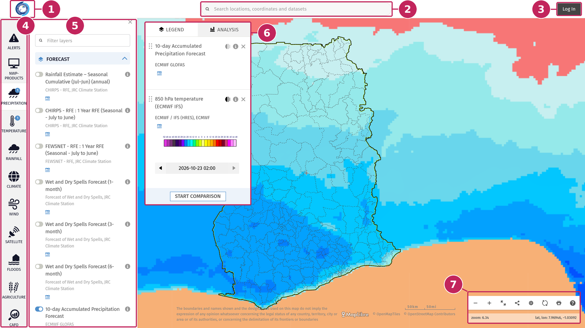

# Mapviewer

The MapViewer is your website’s main interactive map. It brings together geospatial data published by your institution with regional and global products from weather, climate and other sectoral data providers. These include forecasts, observations, satellite products and Common Alerting Protocol (CAP) warnings. Intended to support impact-based forecasting and public alerting, the MapViewer allows anyone to explore, combine and analyse these products over an area of interest.


The screenshots in this guide come from the MapViewer of the [Ghana Meteorological Agency](https://www.meteo.gov.gh/mapviewer/). The logo, themes and data layers you see on your own MapViewer depend on how it has been configured by your administrators.

---

## Overview



**1. Organisation logo**: shows who publishes the map and takes you back to the organisation website.

**2. Search bar**: finds a place, goes to coordinates or looks up a dataset by name.

**3. Log in**: gives access to your account and to data reserved for registered users.

**4. Themes**: the available data is organised into themes, such as Precipitation, Temperature or Wind. Click a theme to browse its data.

**5. Data panel**: lists the sub-themes and data layers of the selected theme. Use the toggles to display layers on the map.

**6. Legend and analysis**: lists the layers displayed on the map with their legend and settings. The **Analysis** tab lets you analyse the data over an area. See [The Legend panel](Legend.md) and [Analysis](Analysis.md).

**7. Map controls**: zoom in and out, show the map only, share the current view, change the map settings, reload or print the map, and open the MapViewer how-to guide. See [Map controls](#map-controls).

---

## Map controls

The map controls are grouped in a toolbar in the bottom-right corner of the map. Hover a button to display its name.

**Zoom out and Zoom in**: the **−** and **+** buttons zoom the map out or in by one level. You can also zoom with the mouse wheel.

**Show map only**: closes the data panel and hides the Legend and analysis panel, to free up space on the map. Click the button again to show the panels. The layers stay on the map.

**Share**: opens a window with a link to the current view, including the position of the map and the layers displayed. Click **COPY** to copy the link, then paste it in an email or a message. You can also share the link on Facebook.

**Map settings**: opens a panel to change the background of the map:

- choose the **basemap** among those available,
- display **administrative boundaries** on the map, or choose **No boundaries**,
- show or hide the **labels** of places,
- show or hide the **roads**.

**Reload map**: reloads the MapViewer in its default view. All the layers you have added are removed and the map goes back to its initial position.

**Print map**: opens a print preview of the map. See [Print the map](#print-the-map).

**Map How-To Guide**: opens the welcome window of the MapViewer. From there, start a guided tour of the main features of the map, or tick **Show me tips** to display tips while you use the map.

Below the buttons, the toolbar shows the current **zoom level** and the **latitude and longitude** of the centre of the map.

```{note}
On mobile devices, the toolbar only shows the **Search** and **Share** buttons.
```

### Print the map

Click **Print map** to open the print preview. The map is printed as it is displayed: same layers, same dates and same basemap. The page contains:

- the logo of your organisation,
- the map, with its scale. Drag the map to adjust the area to print.
- the legend of the layers displayed on the map, under **Map Layers**.

Tick **Add Map Title** to add a title above the map, then click the title to type your own text.

Click **PRINT** to open the print window of your browser, where you can choose a printer or save the map as a PDF file. Click **CANCEL** to close the preview and go back to the map.

```{note}
The **Print map** button is disabled while you compare two maps. Click **EXIT COMPARISON** in the Legend panel to print the map. See [Compare two maps](Legend.md#compare-two-maps).
```

---

```{toctree}
---
maxdepth: 1
---
Header
Browse-Data
Legend
Analysis
Create-Alert
```
